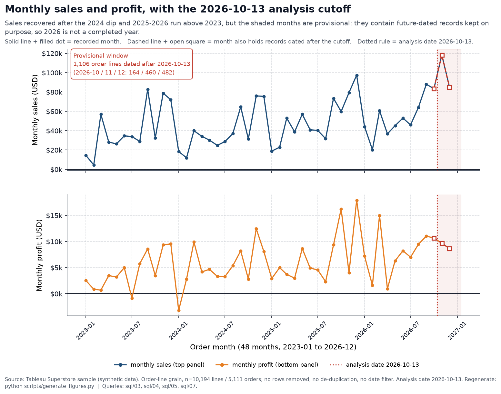

# Superstore Sales & Profitability Analysis

End-to-end data analysis of the Tableau Superstore sample dataset: profiling and cleaning
with Python/Pandas, structured analysis in SQL over SQLite, and reproducible Matplotlib charts.
The project shows where profit is earned and lost across regions, categories, discounts, and
returns.

## Key Results

| KPI | Value |
|---|---|
| Sales | **$2,326,534.35** |
| Profit | **$292,296.81** |
| Profit margin | **12.56%** |
| Orders | **5,111** |
| Average order value | **$455.20** |

- **Discount depth is associated with unprofitable lines.** The 1,415 lines discounted
  above 20% show an aggregate margin of **−37.29%**, against **+29.56%** on undiscounted
  lines. This is a descriptive association, **not proof of causation**.
- **Furniture is the margin drag:** **2.61%** against roughly **17%** for Technology
  (17.45%) and Office Supplies (17.22%).
- **Returns are concentrated in the West:** **11.56%** against about **2.9–3.3%** in the
  other regions.



*Monthly sales and profit (`sql/03`). The months shaded after the dotted line contain records
dated after the fixed analysis date **2026-10-13**, so **2026 is provisional**, not a completed
year. The remaining charts (discount bands, category margin, return rate by region) are embedded
in [`reports/portfolio_insights.md`](reports/portfolio_insights.md).*

Detailed findings: [`reports/portfolio_insights.md`](reports/portfolio_insights.md) ·
[`reports/executive_summary.md`](reports/executive_summary.md)

## Business Questions

- Where is profit concentrated, and where is it lost?
- How are discount levels associated with profitability?
- Which categories, sub-categories, and states underperform?
- Are returns concentrated in particular regions?
- How do sales, profit, and order volume change over time?

## Dataset

Tableau's official "Superstore" sample dataset, obtained from:

- https://public.tableau.com/app/sample-data/sample_-_superstore.xls

The workbook is stored at `data/raw/sample_-_superstore.xls` and is not tracked by
Git. It contains three sheets: `Orders`, `People`, and `Returns`.

**The dataset is not redistributed in this repository** — no copy of the workbook is
committed. Only the analysis code and derived results are published; the source workbook
must be obtained from the link above. This repository makes no claim about the dataset's
license or terms; refer to the source for the applicable terms.

**Grain and size.** One row per order line: **10,194 rows × 21 columns**, covering
**5,111 distinct orders**, **804 customers**, and **1,862 products**. The SQLite database
adds `returns` (296 order-level flags) and `people` (4 regional managers).

**Date range and caveats.**

- Order dates span **2023-01-03 → 2026-12-30**; **no orders are dated 2027**.
- Ship dates extend through **2027-01-05**, including **46 order lines** shipped in 2027.
- **1,106 lines** carry order dates after the project's fixed analysis date,
  **2026-10-13**; **2026 results are therefore provisional** and must not be read as
  completed historical performance.
- **Returns are order-level flags**, not confirmed refunds or financial losses: the data
  has no refund amount and no return date.
- **Counts are non-additive across groups:** category order counts sum to 7,191 against
  5,111 orders overall, and returned-order counts by category sum to 493 against 296
  overall. Always aggregate lines, or use distinct-order measures.

## Tools & Workflow

```text
raw dataset → Python/Pandas notebooks → cleaned CSVs → SQLite → SQL analyses → Markdown reports & Matplotlib charts
```

| Stage | Tool | Output |
|---|---|---|
| Profiling and cleaning | Python / Pandas (Jupyter) | `notebooks/01…`, `notebooks/02…` → `data/processed/*.csv` |
| Storage and validation | SQLite, Python loader | `data/processed/superstore.db` |
| Analysis | SQL (`sql/01`–`sql/10`) | Verified trend, product, discount, regional, returns, customer, shipping, and geographic results |
| Reporting | Markdown, Python/Matplotlib charts | `reports/` (charts in `reports/figures/`) |

Requires Python 3 with pandas, numpy, xlrd, and JupyterLab (ipykernel for execution); the virtual
environment (`.venv/`) is Git-ignored. Regenerating the report charts additionally needs
**Matplotlib**, which is **not yet pinned in [`requirements.txt`](requirements.txt)** — install it
with `pip install matplotlib` or add a pinned `matplotlib==<version>` line to `requirements.txt`.

## Reports

- [`reports/portfolio_insights.md`](reports/portfolio_insights.md) — evidence-based portfolio insights
- [`reports/executive_summary.md`](reports/executive_summary.md) — full executive summary
- [`reports/figures/`](reports/figures) — chart PNGs embedded in the reports (regenerate with `scripts/generate_figures.py`)

## Repository structure

```
data/raw/         # Original source data (ignored by Git)
data/processed/   # Cleaned CSVs and the SQLite database (ignored by Git)
notebooks/        # Jupyter notebooks (data understanding, data cleaning)
sql/              # Schema, validation, and analysis queries (01–10)
scripts/          # Reproducible database loader and chart generator
reports/          # Markdown reports and generated chart PNGs (reports/figures/)
```

## Reproducible setup

Run from the repository root. `data/` is Git-ignored, so place the raw workbook at
`data/raw/sample_-_superstore.xls` first (link above).

1. Create the virtual environment and install the pinned dependencies from
   [`requirements.txt`](requirements.txt) with Python 3:

   ```bash
   python3 -m venv .venv
   .venv/bin/python -m pip install --upgrade pip
   .venv/bin/python -m pip install -r requirements.txt
   ```

   The steps below invoke `.venv/bin/...` directly, so activating the environment is not
   required. The SQLite command-line tool (`sqlite3`) is also needed for the validation and
   query commands; it is a separate system tool, **not** a Python package, so it is not
   installed by `requirements.txt`.

2. Generate the processed CSV files. This **rewrites the tracked notebook**
   `notebooks/02_data_cleaning.ipynb` with fresh execution outputs, so check the result
   and commit it deliberately:

   ```bash
   .venv/bin/jupyter nbconvert --to notebook --execute --inplace notebooks/02_data_cleaning.ipynb
   ```

3. Create or rebuild the database. The loader uses only the Python standard
   library and is safe to re-run (tables are dropped and recreated first):

   ```bash
   .venv/bin/python scripts/load_superstore_db.py
   ```

4. Inspect the validation results:

   ```bash
   sqlite3 -header -column data/processed/superstore.db < sql/02_validate_database.sql
   ```

5. (Optional) Regenerate the report charts. This reads the database read-only and rewrites the
   PNGs under `reports/figures/`. It requires Matplotlib (see the note above):

   ```bash
   .venv/bin/python scripts/generate_figures.py
   ```

### Analysis entry points

| Entry point | Command |
|---|---|
| Data understanding (exploratory) | `.venv/bin/jupyter nbconvert --to notebook --execute --output-dir=/tmp notebooks/01_data_understanding.ipynb` |
| Data cleaning | Same command as **step 2** above |
| SQL analyses (`sql/03`–`sql/10`) | `sqlite3 -header -column data/processed/superstore.db < sql/03_sales_trends.sql` (same pattern for `sql/04`–`sql/10`) |
| Report charts | `.venv/bin/python scripts/generate_figures.py` |

Side effects: the data-understanding command writes its executed copy to `/tmp`, leaving
the tracked notebook untouched. The cleaning command in **step 2** uses `--inplace` and
deliberately rewrites `notebooks/02_data_cleaning.ipynb`, as noted there.

Relevant files:

- `scripts/load_superstore_db.py` — loads the processed CSVs into the database
- `sql/01_create_database.sql` — schema (grain, types, keys, foreign key)
- `sql/02_validate_database.sql` — read-only validation queries
- `data/processed/superstore.db` — generated database (ignored by Git)
