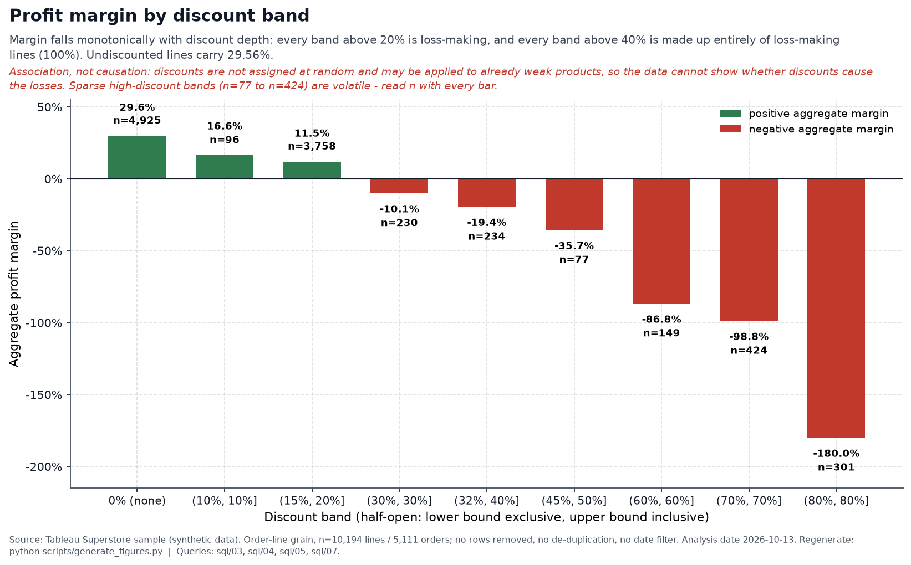
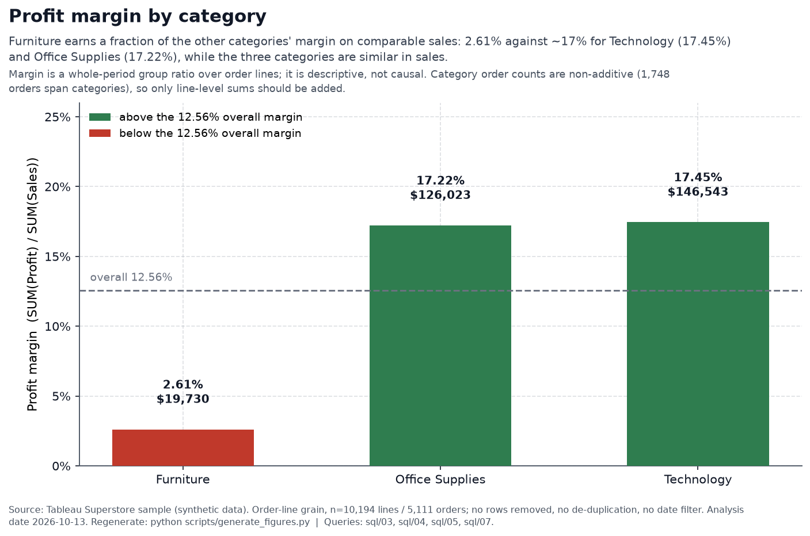
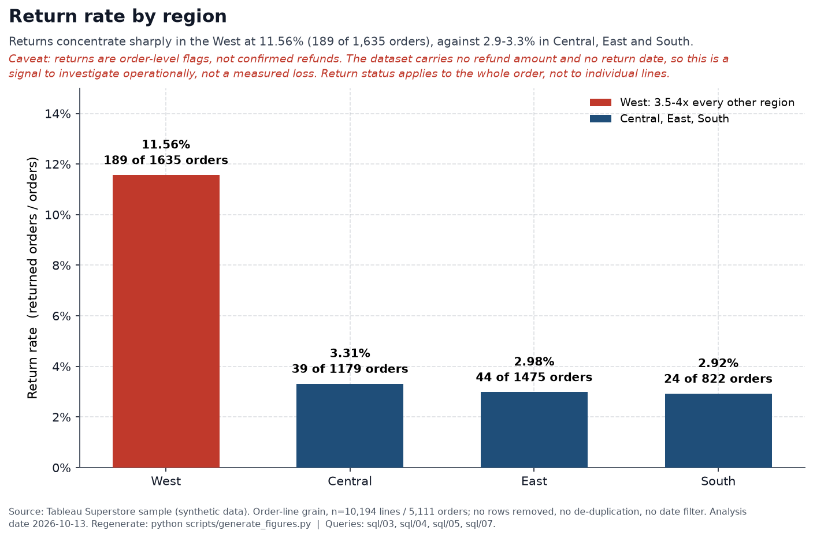

# Superstore Sales & Profitability — Portfolio Insights

Evidence-based business insights from the Tableau Superstore sample dataset, written
for a Data Analyst portfolio. Every figure below was independently re-computed from
`data/processed/superstore.db` (read-only SQL) for this report and cross-checked
against the project's SQL, notebooks, and `reports/executive_summary.md`. The charts
are rendered by `scripts/generate_figures.py`, which executes the same `sql/03`,
`sql/04`, `sql/05`, and `sql/07` statements against that database, so every chart
matches the table beside it.

**Scope.** Whole dataset, order-line grain, no de-duplication, no date filter; Canadian
and future-dated records are retained (see *Dataset caveats*). All statements are
**descriptive associations, not causal claims**.

## KPI reconciliation

| KPI | Documentation | Independent recompute | Match |
|---|---|---|---|
| Sales | 2,326,534.35 | 2,326,534.35 | Yes |
| Profit | 292,296.81 | 292,296.81 | Yes |
| Profit margin | 12.56% | 12.56% | Yes |
| Orders (distinct `Order ID`) | 5,111 | 5,111 | Yes |
| Units sold | 38,654 | 38,654 | Yes |
| Average order value | 455.20 | 455.20 | Yes |
| Returned orders / rate | 296 / 5.79% | 296 / 5.79% | Yes |

No numerical discrepancies were found between the report and the database. The pipeline
(raw → cleaned CSVs → SQLite) is internally consistent and reproducible
(`scripts/load_superstore_db.py`, `sql/01`, `sql/02`).

## Dataset caveats (dates)

- **Order dates:** 2023-01-03 → **2026-12-30**. **No order dates fall in 2027.**
- **Ship dates:** 2023-01-07 → **2027-01-05**; **46 lines** ship in early 2027. These are
  ship dates of orders placed in late 2026, not 2027 order activity.
- The project fixes its reporting date at **2026-10-13**. **1,106 of 2026's 3,379 lines
  (32.7%) are dated after that date**, including the single highest-sales month,
  **2026-11 ($118,454.51, 460 lines)**. 2026 is therefore **incomplete/provisional** and is
  never presented here as completed historical performance.
- Non-additivity: category `Orders` sum to 7,191 vs 5,111 overall (1,748 orders span
  categories); returned-order counts by category sum to 493 vs 296 overall. Only line-level
  sums are additive.

---

## Insight 1 — Discount depth is strongly associated with unprofitable lines

**Insight.** Profitability declines monotonically as discount depth increases. Every band
above 20% has a negative aggregate margin, and every band above 40% is 100% loss-making.

**Evidence** (order-line grain):

| Discount band | Lines | Loss-making lines | Loss % | Sales | Profit | Margin |
|---|---:|---:|---:|---:|---:|---:|
| 0.00 | 4,925 | 0 | 0.0% | 1,105,323.79 | 326,718.59 | 29.56% |
| (0.00, 0.10] | 96 | 4 | 4.2% | 54,952.50 | 9,099.97 | 16.56% |
| (0.10, 0.20] | 3,758 | 527 | 14.0% | 801,497.92 | 92,498.94 | 11.54% |
| (0.20, 0.30] | 230 | 211 | 91.7% | 104,474.07 | −10,513.45 | −10.06% |
| (0.30, 0.40] | 234 | 208 | 88.9% | 130,991.22 | −25,477.51 | −19.45% |
| (0.40, 0.50] | 77 | 77 | 100.0% | 64,403.51 | −22,999.54 | −35.71% |
| (0.50, 0.60] | 149 | 149 | 100.0% | 7,105.94 | −6,164.35 | −86.75% |
| (0.60, 0.70] | 424 | 424 | 100.0% | 40,805.27 | −40,300.57 | −98.76% |
| (0.70, 0.80] | 301 | 301 | 100.0% | 16,980.15 | −30,565.27 | −180.01% |

- 51.7% of all 10,194 lines (5,269) carry a discount. Discounts range 0.0–0.8 across 12 values.
- Lines discounted **> 20%**: 1,415 lines, **1,370 loss-making (96.8%)**, aggregate margin **−37.29%**.

*Aggregate profit margin by discount band (`sql/05`). `n` is the number of order lines in each
band; the two sparsest bands (`n=96`, `n=77`) have volatile margins. The relationship is a
descriptive association, not evidence that discounts cause the losses.*

**Business interpretation.** Discount policy is the strongest profit lever visible in the
data; deep discounting is where portfolio profit is destroyed and is worth a pricing-governance
review.

**Confidence & limitations.** High confidence in the *association* (large, monotonic, consistent).
Two bands are small samples — `(0.00, 0.10]` (n=96) and `(0.40, 0.50]` (n=77) — so treat their
exact margins cautiously; the pattern is carried by the robust `0.00` (n=4,925) and
`(0.10, 0.20]` (n=3,758) bands and the larger deep-discount bands. **Causation is not
established:** the data cannot tell whether discounts cause losses or unprofitable products
are discounted to move them.

**Evidence location.** `sql/05_discount_analysis.sql`; `reports/executive_summary.md` §5.

## Insight 2 — Furniture is the profitability drag, concentrated in Tables and Bookcases

**Insight.** Furniture earns a 2.61% margin versus ~17% for the other categories and contains
the largest sub-category losses.

**Evidence.**

| Category | Sales | Profit | Margin | Loss-making lines |
|---|---:|---:|---:|---:|
| Technology | 839,893.28 | 146,543.38 | 17.45% | 271 |
| Office Supplies | 731,893.31 | 126,023.44 | 17.22% | 898 |
| Furniture | 754,747.76 | 19,730.00 | 2.61% | 732 |

Worst sub-categories: **Tables −17,753.21 (−8.53%)**, **Bookcases −3,632.07 (−3.15%)**,
**Supplies −1,171.39 (−2.51%)**.

*Profit margin by category (`sql/04`), with profit dollars on each bar; the dashed rule is the
12.56% overall margin. Furniture earns a comparable share of sales but a fraction of the profit.*

**Business interpretation.** Furniture generates revenue on par with the other categories but a
fraction of the profit; the drag is concentrated in high-ticket furniture rather than spread
evenly.

**Confidence & limitations.** High confidence in the ranking. The *cause* (sourcing, shipping,
discounting) is not observable — the dataset has no cost or inventory fields. Category order
counts are non-additive, so only line-level sums should be added.

**Evidence location.** `sql/04_product_profitability.sql`; `reports/executive_summary.md` §4.

## Insight 3 — Returns are sharply concentrated in the West region

**Insight.** The West's return rate (~11.6%) is roughly 3.5–4× every other region (~2.9–3.3%).

**Evidence.** Returned orders 296 (5.79%). By region:

| Region | Orders | Returned | Return rate |
|---|---:|---:|---:|
| West | 1,635 | 189 | 11.56% |
| Central | 1,179 | 39 | 3.31% |
| East | 1,475 | 44 | 2.98% |
| South | 822 | 24 | 2.92% |

Returned-order sales 180,504.28 (7.76% of sales); profit on those lines 23,232.36.

*Return rate by region (`sql/07`), with returned/total orders on each bar. These are orders
flagged as returned, not confirmed refunds — the dataset carries no refund amount.*

**Business interpretation.** A specific, sizeable, localized signal worth operational
investigation (product mix, fulfilment, or customer expectations in the West).

**Confidence & limitations.** High confidence in the rate differences. **Returns are order-level
flags, not refunds** — there is no refund amount or return date, so these figures are activity
*associated with* returned orders, not confirmed losses. Returned-order counts are non-additive
(sum 493 by category vs 296 overall). The reason for the West gap is unknown.

**Evidence location.** `sql/07_returns_analysis.sql`; `reports/executive_summary.md` §6.

## Insight 4 — A few states drive outsized losses; Canada is small but highly profitable

**Insight.** Losses are geographically concentrated, while one small country grouping shows the
best margin.

**Evidence.** States with the largest losses: Texas −25,729.36 (−15.12%), Ohio −16,971.38
(−21.69%), Pennsylvania −15,559.96 (−13.35%), Illinois −12,607.89 (−15.73%), North Carolina
−7,490.91, Colorado −6,527.86. Texas + Ohio ≈ **−42,700.74**. By country: Canada 29,333.49 sales
at **20.11%** margin (5,899.79) vs United States 2,297,200.86 at 12.47%.

**Business interpretation.** A small number of states account for a disproportionate share of
negative profit and warrant state-level margin review. Canada's margin is notably high but on a
tiny base.

**Confidence & limitations.** High confidence in the aggregation. Small locations can be volatile;
region/country order counts are non-additive. `Country/Region` and `Region` are distinct groupings
(Canada maps only to Central/East/West).

**Evidence location.** `sql/10_geographic_analysis.sql`, `sql/06_regional_segment_analysis.sql`;
`reports/executive_summary.md` §6.

## Insight 5 — Order/unit growth is real, but 2026 is incomplete

**Insight.** Orders and units rose every year; sales dipped in 2024 then recovered, and 2026 is
materially future-dated.

**Evidence.**

| Year | Orders | Units | Sales | Profit | Margin |
|---|---:|---:|---:|---:|---:|
| 2023 | 995 | 7,813 | 494,040.21 | 51,684.30 | 10.46% |
| 2024 | 1,053 | 8,086 | 472,993.03 | 62,020.97 | 13.11% |
| 2025 | 1,340 | 10,018 | 613,933.58 | 82,665.20 | 13.46% |
| 2026 | 1,723 | 12,737 | 745,567.53 | 95,926.35 | 12.87% |

Annual figures reconcile to the totals (orders 995+1,053+1,340+1,723 = 5,111;
units = 38,654; sales = 2,326,534.35). However, **1,106 of 2026's 3,379 lines (32.7%) are dated
after 2026-10-13** (2026-10: 164; 2026-11: 460; 2026-12: 482), and the highest-sales month
2026-11 is 100% future-dated.

*Monthly sales and profit, 2023-01 to 2026-12 (`sql/03`). The three shaded months (2026-10 to
2026-12) are drawn dashed because they contain records dated after the 2026-10-13 analysis date;
2026 is therefore provisional and is not presented as a completed year.*

**Business interpretation.** Order/unit growth is a defensible within-record trend, but 2026
revenue/profit and any year-over-year comparison involving 2026 are provisional and must be
labelled as such.

**Confidence & limitations.** High confidence in the counts. Future-dated records are retained
deliberately (not treated as invalid) but are also not completed performance.

**Evidence location.** `sql/03_sales_trends.sql`; `notebooks/01_data_understanding.ipynb` §5.3;
`reports/executive_summary.md` §3.

---

## Association vs causation

| Statement | Status |
|---|---|
| Discount depth tracks lower/negative margin | Verified association |
| Deep discounts *cause* losses | Hypothesis (not testable here) |
| Furniture margin ~2.6%; Tables/Bookcases largest losses | Verified |
| West return rate ~3.5–4× other regions | Verified |
| West return gap driven by mix/fulfilment | Hypothesis |
| Few states concentrate losses | Verified |
| 2026 incomplete / future-dated | Verified |
| Returns equal confirmed refunds/losses | Rejected (flags only) |

## Recommended next step

Build a **profit-driver waterfall** for the executive view, decomposed in **profit dollars**
(not margin percentages). The three components reconcile exactly to total profit:

- Undiscounted lines (discount = 0): **+326,718.59** (4,925 lines)
- Shallow discounts (0 < discount ≤ 20%): **+101,598.91** (3,854 lines)
- Deep discounts (discount > 20%): **−136,020.69** (1,415 lines; 1,370 loss-making)
- **Total: 292,296.81** (= 326,718.59 + 101,598.91 − 136,020.69)

This translates Insight 1 into a single visual while preserving the association-only caveat.
Not created here; pending approval.
